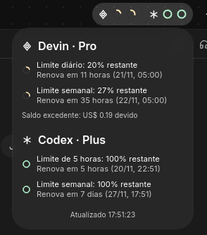

# Devin para Buzz 1.x.x

Harness local via ACP. ID do plugin: `john.devin`; tipo de agente: `john.devin/devin`.

> Compatibilidade: plugin para o **Buzz 1.x.x** (aplicativo desktop novo). Não se aplica ao Buzz legado.

## Instalar

1. Confirme que `devin` está no PATH herdado pelo aplicativo Buzz. Faça `devin auth login` no terminal se necessário; não cole credenciais no chat.
2. No Buzz desktop: **Settings → Plugins → Manage plugins → Add → Browse**.
3. Selecione a pasta deste plugin (por exemplo `~/.buzz/PLUGINS/DEVIN_HARNESS`), revise as permissões e clique em **Install plugin**.
4. Em **Agents → New agent → Import an agent**, selecione um agente antigo e o harness **Devin**. Revise modelo, pasta e instruções antes de salvar. Pare a instância antiga antes de conectar.
5. Mencione primeiro um agente com uma pergunta simples. Quando houver pedido de permissão, abra a página **Devin** na navegação do Buzz.

A instalação depende da revisão do proprietário exigida pelo Buzz. Não altera os arquivos Legacy nem importa agentes automaticamente. Depois da instalação, o agente pode verificar a ativação e recarregar esta mesma pasta pelo recurso de desenvolvimento de plugins.

## Acesso solicitado

- Executar `devin acp` e consultar `devin version`, sem shell intermediário.
- Hospedar um servidor MCP local para as ferramentas Buzz do agente em execução.
- Ler arquivos para anexos enviados pelo agente, relativos à pasta configurada quando o caminho não é absoluto; também lê `credentials.toml` do Devin e `auth.json` do Codex para o indicador de limites, sem persistir nem exibir os segredos.
- Rede para `server.codeium.com` (GetUserStatus do Devin) e `chatgpt.com` (wham/usage do Codex) no indicador de limites.
- Executar um script `sh` somente leitura que localiza o `rollout-*.jsonl` mais recente em `~/.codex/sessions` e extrai o último evento `rate_limits`, usado como fallback quando o token do Codex expira.

Plugins Buzz são código confiável e sem sandbox. O processo Devin usa a conta local já autenticada e pode consumir a cota/plano dessa conta. Não há chave nem login armazenado neste plugin. As permissões do executável Devin e das ferramentas Buzz continuam relevantes.

Em **agente → Identity → Permissão**, escolha Perguntar (`auto`, padrão preservado), permitir edições (`accept-edits`), Smart ou Bypass (`dangerous`). Smart usa o avaliador do próprio Devin para liberar ações consideradas seguras; Bypass libera todas as ferramentas, sujeito às políticas da organização. O plugin configura o ambiente do processo e seleciona o modo ACP correspondente, recusando executar se o Devin não o anunciar. Não altera configurações globais da conta.

Pedidos ACP restantes só recebem consentimento após clique em **Permitir uma vez**. Nenhum consentimento permanente é oferecido. Pedidos pendentes expiram após dois minutos. O painel exibe argumentos, conteúdo textual, diff e locais informados pelo Devin; se não houver detalhes, informa explicitamente a ausência. As instruções do agente nunca substituem a configuração salva pelo proprietário.

## Comportamento e limites

- O seletor de modelo é uma pílula compacta, como nos harnesses nativos, e consulta o Devin autenticado por ACP (`initialize` e `session/new`, sem prompt nem ferramentas MCP), com cache de um minuto por pasta e prazo de 15 segundos. No cartão do agente cada escolha salva na hora pelo `onChange` do host; em caso de erro, **Tentar novamente** repete a consulta. Modelo em branco usa o padrão da conta. Identificadores importados são preservados mesmo se não constarem do catálogo. A lista também é oferecida ao seletor nativo de modelos por mensagem do Buzz; essa seleção tem precedência sobre o modelo salvo.
- A aba **Identity** reúne Harness (linha do host), Modelo, Permissão e Mensagem durante turno, com Instruções abaixo; a pasta de trabalho fica na aba **Settings** junto ao gerenciamento do host. A aba **Activity** lista a conversa atual e as conversas recentes registradas por este app (máx. 12), com estado, horário e última atividade; **Abrir conversa** navega para a thread do Buzz.
- Importação de catálogo reconhece runtime `devin` sem provider externo; conserva o modelo publicado. Migração de tipo preserva instruções e pasta pelo contrato `carry` do Buzz.
- Cada turno cria e encerra um processo/sessão ACP, levando o histórico disponibilizado pelo Buzz. Não mantém raciocínio privado ou sessão nativa entre turnos. Isso pode aumentar o uso de contexto.
- Ferramentas Buzz por MCP; resposta textual automática somente quando não houve envio bem-sucedido via ferramenta `send`/`reply_in_subthread`.
- Stop, deadline e desativação encerram o processo e cancelam permissões pendentes. O seletor **Mensagem durante turno** define o que acontece quando chega mensagem do Buzz no meio de um turno: **Fila** (padrão) recusa um segundo turno simultâneo na mesma conversa; **Steer** injeta a mensagem na sessão ACP em execução (`session/prompt` no mesmo `sessionId`, sem reenviar o prompt do sistema), que o Devin incorpora ao turno; as duas chamadas resolvem juntas e a resposta agregada sai pela entrega original. Steer só vale com o prompt do turno em voo; durante a preparação da sessão ou a coleta de estatísticas a entrega é recusada como na Fila. Uma entrega incorporada não cria processo, não coleta `/session-stats` nem grava uso próprio, e o Stop dela cancela apenas a espera (a mensagem já entrou na sessão); permissões e o transcript ficam com a entrega dona.
- Turnos limitados a 30 minutos pelo host; o prompt ACP tem deadline de 29 minutos.
- Após cada turno, o uso real por request é lido do `/session-stats` (sem inferência) e gravado por agente/conversa, exposto ao plugin Usage do Buzz pelo contrato `usage`. O `inputTokens` do Devin inclui cache e é separado na gravação. Cada request guarda o próprio rótulo de modelo (a cobrança varia por modelo: swe-2 é incluído no plano, Claude-via-Devin consome) e qualquer `acuCost`/`creditCost` reportado; `acuAmount` do `usage_update` entra no fallback consolidado. Custo em USD depende do `tokenCostUsd` que o Devin reportar e pode ficar parcial.
- O indicador de limites fica no chrome ao lado da busca: um cluster ícone+dois anéis por provider detectado (Devin, Codex), com popover por hover/foco/click mostrando plano, % restante e renovações. O anel do Codex exibe o restante (100 menos o uso) das janelas de 5h e semanal; token expirado usa o último rollout local como fallback e indica a origem. Um painel com o mesmo detalhe e botão Atualizar responde ao alvo `devin:quota`.

  
- Sem voz, execução remota, retomada de sessão nativa ou proteção nativa do Buzz. Agentes protegidos são recusados.
- A ativação na instalação real e a importação de um agente precisam ser verificadas após a revisão de instalação. Testes locais não substituem essa validação.

## Validar

`npm test` roda a suíte completa local sem rede, conta ou dependências externas.

`node smoke-acp.mjs` envia um prompt mínimo real ao Devin usando o login local (pode consumir uso). Confirma initialize, criação de sessão e resposta `OK`. Não usa ferramentas Buzz nem publica mensagens.

Validação em 2026-11-11: suíte local com 9 testes passou; smoke ACP real passou; `devin auth status` confirmou login local. Nenhuma credencial foi copiada.

## Referências do contrato

- https://github.com/block/buzz-app/blob/main/docs/plugin-architecture.md
- https://github.com/block/buzz-app/blob/main/src/features/agents/service.ts
- https://github.com/block/buzz-app/blob/main/src/features/agent-harness/kit.ts
- https://github.com/block/buzz-app/blob/main/src/features/host/service.ts
- Guia integrado `plugin_authoring_guide`, consultado em 2026-11-11.
- CLI instalado: `devin --help` e `devin acp --help`.
